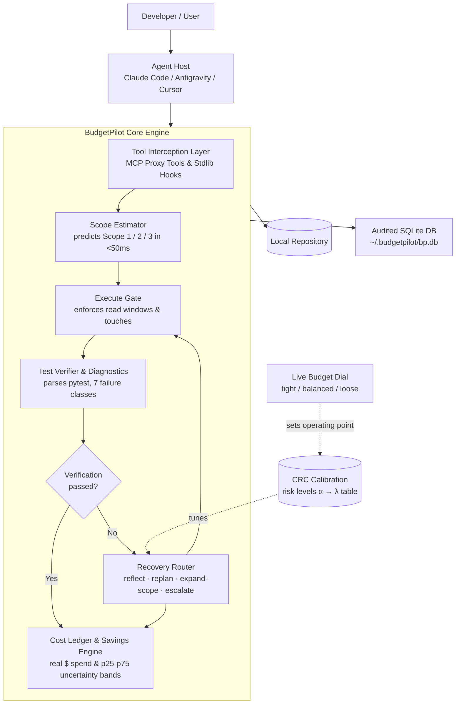

# BudgetPilot

**A budget-aware decision engine for AI coding agents.**

> 🚀 **Status: Production Ready (v1.0.0 — Phases A through P Complete).**
> BudgetPilot is fully implemented, packaged, and verified. 100% of test suites pass across all 11 architecture columns, conformal calibration passes, and safety envelopes.
> For new contributors, see the comprehensive [Master Architecture & Project Documentation](file:///home/aleena/Documents/Projects/BudgetPilot_MCP/docs/MASTER_DOCUMENTATION.md).

---

## Abstract

Coding agents built on large language models are increasingly used for real software engineering work, but they are inefficient spenders. They routinely default to *maximum-context-first execution* — re-reading files and re-scanning directories for edits that need almost none of it — and when an attempt fails, they default to escalating to a larger, more expensive model, even when a cheap local repair would have worked just as well.

**BudgetPilot** closes that gap. It is an installable [MCP 2.x](https://modelcontextprotocol.io/) server and ultra-low latency hook engine (<60ms SLA) that sits between an agent host (Google Antigravity, Claude Code, Cursor) and the underlying tool layer. It estimates task scope before an agent over-reads, enforces a minimum-viable execution path via the Execute Gate, and — on failure — routes to the cheapest action likely to succeed from a four-action recovery set (**reflect**, **replan**, **expand-scope**, **escalate**).

A single conformal budget dial (**tight**, **balanced**, **loose**), backed by finite-sample Conformal Risk Control (CRC), allows developers to trade cost for solve rate without retraining. All expenditures are tracked against real cloud pricing with audited SQLite persistence, automated secret redaction, and strict network isolation to the local Ollama host.

**Source inspiration:**
1. Yin & Feng, *"Do AI Agents Know When a Task Is Simple? Toward Complexity-Aware Reasoning and Execution,"* (E3 / MSE-Bench), arXiv:2607.13034
2. He et al., *"CodeRescue: Budget-Calibrated Recovery Routing for Coding Agents,"* arXiv:2607.19338

---

## The Architecture & Pipeline

BudgetPilot wraps agent tool invocations cleanly without requiring prompt modifications:



### The 11 Core Functional Columns

1. **Tool Interception**: MCP 2.x standard server & stdlib hooks shim (<60ms SLA).
2. **Scope Estimator**: Fast lexical heuristics and ripgrep identifier probe (<50ms execution).
3. **Execute Gate**: Scope-based enforcement matrix (Scope 1/2/3), 400/800 line windows, 3-turn overrides.
4. **Test Verifier**: Subprocess pytest capture, output normalization, and 7-class failure taxonomy.
5. **Recovery Router**: Utility maximization $U(a) = P_{\text{success}}(a \mid fc) - \lambda \cdot C_{\text{norm}}(a)$ with Laplace smoothing.
6. **Dependency Frontier**: Root-cause traceback parsing and `expand-scope` target discovery.
7. **Worktree Escalation**: Sandboxed strong-tier model sub-runs in isolated temporary git worktrees.
8. **Conformal Risk Control (CRC)**: Distribution-free calibration mapping risk bounds $\alpha$ to cost penalty $\lambda$.
9. **Budget Dial**: Live runtime slider (`tight`, `balanced`, `loose`) with zero model retraining.
10. **Financial Ledger & Savings Engine**: Multi-metric accounting with p25–p75 uncertainty bands (`low_usd <= avoided_usd <= high_usd`).
11. **Safety & Hardening**: Emergency kill switch (`BP_MODE=off`), automated secret redaction, per-task cap guards, and network egress auditing.

---

## Installation & Setup

### Prerequisites

- **Python**: 3.11+ (Python 3.11, 3.12, 3.13, 3.14 supported)
- **Git**: Installed and available in PATH
- **Ripgrep (`rg`)**: Available in PATH for fast identifier probing
- **Ollama**: Local Ollama instance running with tool-calling models (e.g., `qwen2.5:3b`, `qwen3:4b`):
  ```bash
  ollama run qwen2.5:3b
  ```

### Installation

Clone the repository and install BudgetPilot in editable mode:

```bash
git clone https://github.com/AleenaAntony19/BudgetPilot_MCP.git
cd BudgetPilot_MCP
pip install -e .
```

Verify your environment with `bp doctor`:

```bash
bp doctor
```

Output:
```
=======================================================
 BudgetPilot Doctor — System Diagnostics
=======================================================

[PASS] Ollama Server: Reachable (found 2 models)
       Models: qwen2.5:3b, qwen3:4b
[PASS] Tool-Calling Models: qwen2.5:3b, qwen3:4b
[PASS] Git: Available (/usr/bin/git)
[PASS] Ripgrep (rg): Available (/usr/bin/rg)
[PASS] Database & Storage: Healthy at ~/.budgetpilot (14 core tables, WAL active, integrity OK)
[PASS] Prices Configuration: Valid (~/.budgetpilot/prices.json)
       Tiers: cheap ($ 1.00/M in, $ 2.00/M out), strong ($ 3.00/M in, $ 6.00/M out)
[PASS] Gate Interception Latency: SLA satisfied (p95=0.03ms < 60ms target)
       Percentiles: p50=0.02ms, p95=0.03ms, p99=0.05ms (50 samples)

-------------------------------------------------------
 Diagnostics Result: 7/7 checks passed.
-------------------------------------------------------
```

---

## CLI Usage

BudgetPilot provides a unified CLI entrypoint via `bp`. For complete options, flags, and workflow examples, see the [Operations & CLI Reference](file:///home/aleena/Documents/Projects/BudgetPilot_MCP/docs/COMMANDS.md).

### 1. Interactive Chat (`bp chat`)

Run an interactive chat session with live token telemetry, advisory anomaly detection (mean + 2σ outlier alerts), and real-time cloud pricing:

```bash
bp chat --tier cheap
```

```text
===== BudgetPilot Status =====
Status: OK
Within expected bounds.
Latency anomaly: False
Input token anomaly: False
Output token anomaly: False

Input tokens: 184
Output tokens: 42
Estimated cloud cost: $ 0.000268
Generation time: 0.84 seconds
```

### 2. Autonomous Task Execution (`bp run`)

Run an autonomous coding task against any local repository with active Execute Gate enforcement, automated test verification, and recovery routing:

```bash
bp run --task "Fix IndexError in calculate_discount when cart is empty" --repo . --mode enforce --tier cheap
```

Options:
- `--mode`: `enforce` (active gating), `observe` (passive logging without blocking), `off` (complete bypass).
- `--tier`: `cheap` (local model) or `strong` (frontier model).
- `--max-turns`: Maximum allowable turns per task (default: 20).
- `--budget`: Initial budget dial position (`tight`, `balanced`, `loose`).

### 3. Live Budget Dial (`bp budget`)

Inspect or adjust the runtime risk/cost tradeoff dynamically without restarting services or retraining models:

```bash
# View active budget dial position and calibrated risk parameters
bp budget

# Set budget dial to tight (aggressive savings, higher risk of replan)
bp budget tight

# Set budget dial to balanced (optimal trade-off, default)
bp budget balanced

# Set budget dial to loose (higher escalation allowance, lowest failure risk)
bp budget loose
```

### 4. Benchmarking & Evaluation (`bp bench`)

#### Run Baseline Benchmark (Ungated)
```bash
bp bench baseline --suite bench/tasks.example.yaml --repeats 3
```

#### Run Multi-Arm Benchmark Suite
Evaluates all arms (`off`, `observe`, `tight`, `balanced`, `loose`) in isolated temporary git worktrees:
```bash
bp bench run --suite bench/tasks.example.yaml --arms off,tight,balanced,loose --repeats 3 --cost-cap-usd 0.50
```

#### Generate Comprehensive HTML/Terminal Reports
```bash
# Generate terminal report with bootstrap confidence intervals and paired savings
bp report --latest

# Generate interactive HTML dashboard
bp report --format html --output report.html
```

### 5. System Status (`bp status`)

Check runtime mode, active budget slider, calibrated CRC bounds, and aggregate dollar savings:

```bash
bp status
```

---

## Safety & Hardening (Phase O)

BudgetPilot incorporates defense-in-depth safety controls engineered for secure agent operation:

### 1. Global Kill Switch (`BP_MODE=off`)
Setting `BP_MODE=off` in your environment or CLI activates an immediate, top-level bypass. All Execute Gate checks, tool restrictions, and recovery rerouting instantly fail-open to standard agent execution:
```bash
export BP_MODE=off
```

### 2. Automated Secret Redaction
All intercepted tool inputs, outputs, SQLite records, and fallback logs are automatically scanned and redacted prior to storage. BudgetPilot intercepts:
- **AWS Keys**: `AKIA...` access keys and 40-character secret keys (`[REDACTED_AWS_KEY]`)
- **Tokens**: GitHub PATs (`ghp_...`, `gho_...`), Slack tokens (`xox[baprs]-...`), Bearer headers
- **Cryptographic Keys**: RSA, EC, OpenSSH, PGP private key blocks (`[REDACTED_PRIVATE_KEY]`)
- **JWTs**: RFC 7519 JSON Web Tokens (`[REDACTED_JWT]`)

### 3. Hard Per-Task Cap Guards (`TaskCapGuard`)
Prevents runaway financial spend and infinite loops during autonomous execution:
- **Max Denials**: Max 5 gate denials per task before auto-switching to `observe` mode.
- **Max Recovery Attempts**: Max 3 recovery loops per task.
- **Max Turns**: Hard cap of 25 turns per task.
- **Max Escalation Spend**: Hard cap of $1.00 USD per task during strong-tier escalation.

### 4. Network Egress Confinement
BudgetPilot is strictly local-first. Network audits verify that the only outbound network connections permitted are to the authorized local Ollama host (`localhost`, `127.0.0.1`, or `OLLAMA_HOST`). Any attempt to establish external outbound socket connections raises a `PermissionError` and halts the unauthorized call.

---

## Host Integration (MCP & Hooks)

### Google Antigravity Configuration

Add BudgetPilot to your Antigravity global MCP server configuration (`~/.gemini/config/mcp_config.json`):

```json
{
  "mcpServers": {
    "budgetpilot": {
      "command": "python",
      "args": [
        "-m",
        "budgetpilot.adapters.mcp_server",
        "--repo",
        "${workspaceRoot}",
        "--mode",
        "enforce"
      ],
      "env": {
        "BP_MODE": "enforce",
        "BP_BUDGET": "balanced"
      }
    }
  }
}
```

### MCP Host Control & Proxy Tools

When integrated into an MCP client, BudgetPilot exposes two sets of native tools:

1. **Control Tools**:
   - `bp_status`: Inspect current task state, turn count, read/touched sets, and estimated dollar spend.
   - `bp_escalate`: Request immediate escalation of the task to a frontier model in a bounded git worktree.
   - `bp_set_budget`: Adjust the runtime budget slider operating point (`tight`, `balanced`, `loose`).
   - `bp_request_scope`: Proactively request a higher execution scope (Scope 1 $\to$ 2 $\to$ 3) with justification.
   - `bp_report`: Fetch a financial and gate-interception report for the active session.

2. **Proxy Tools (Gate-Enforced)**:
   - `bp_list_dir`: Path-confined directory listing with scope depth clamping.
   - `bp_search`: Ripgrep lexical search with package-level scoping.
   - `bp_read_file`: Read file contents enforced with 400/800 line clamping and maximum file budgets.
   - `bp_edit_file`: Exact unique replace with pre-edit validation and diff tracking.
   - `bp_run_tests`: Subprocess test execution capturing failure taxonomy and test outputs.

---

## Testing & Verification

BudgetPilot maintains a comprehensive test suite covering 100% of all pipeline stages and strict architecture invariants:

```bash
pytest -v
```

```text
======================= 288 passed, 1 skipped in 12.45s ========================
```

Key guarantees verified in tests:
- **Zero Forbidden Imports**: `budgetpilot.core` and `budgetpilot.bench` contain zero imports of `ollama`, `mcp`, `fastapi`, or `uvicorn`.
- **Latency SLA**: Gate checks execute in <0.05ms (SLA target: <60ms).
- **Conformal Risk Coverage**: Empirical risk bounds tested via 5,000-draw Monte Carlo simulations.
- **Uncertainty Bounds**: Modeled savings strictly guarantee `low_usd <= avoided_usd <= high_usd`.

---

## Team & Credits

- **Aleena Antony** — Plugin core, tool interception, Estimate/Execute gate, cost ledger, safety hardening
- **Adithyan Biju** — Recovery router, CRC calibration, budget slider wiring, benchmark analysis

---

## License

MIT License. See [LICENSE](LICENSE) for details.
