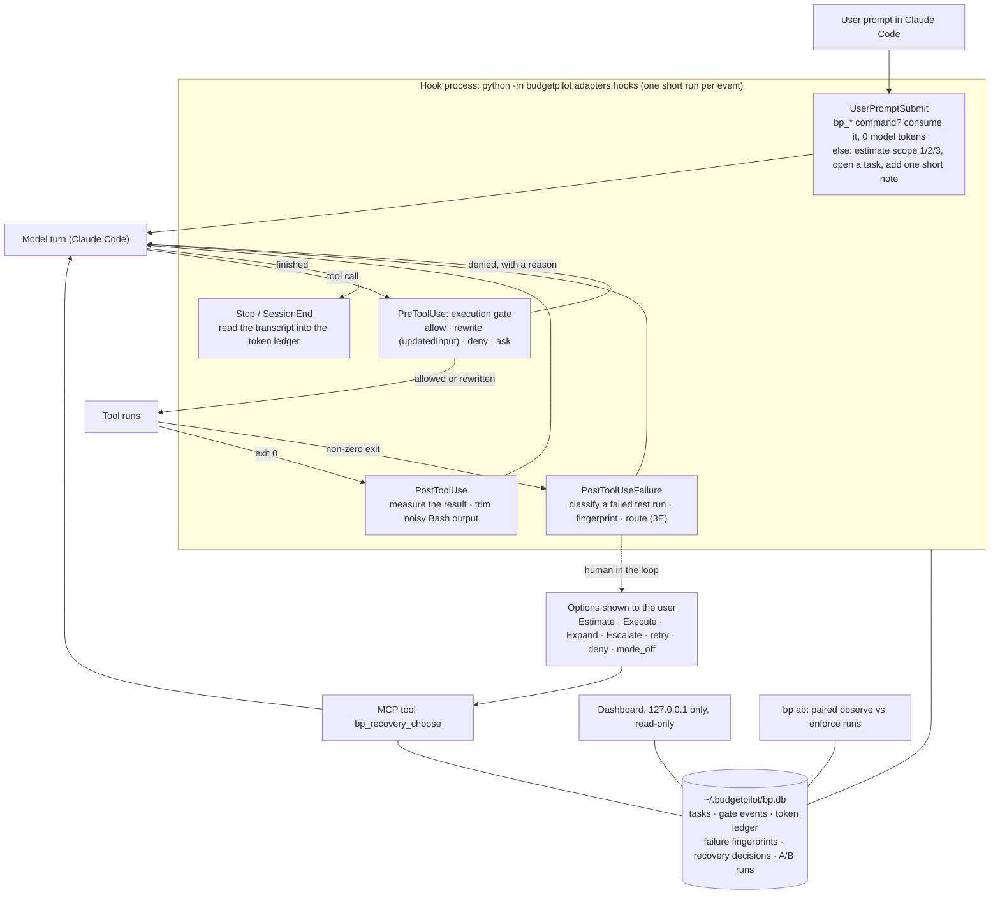

# BudgetPilot architecture

BudgetPilot is a set of Claude Code hooks, a small MCP server and a local dashboard. It never calls a model. Claude Code, logged in with the user's plan, is the model; BudgetPilot acts at the edges of each tool call.

## Flow

## Stages

| Stage | Where | What it does |
|---|---|---|
| 1. Estimate | `core/estimator.py`, called from `UserPromptSubmit` | Counts the prompt (estimate), looks for named files, tracebacks and broad wording, and picks scope 1, 2 or 3. On low confidence it rounds the scope **up**. The scope sets every limit below. |
| 2. Gate | `core/ccgate.py`, called from `PreToolUse` | Narrows unbounded `Read` and `Grep` calls through `updatedInput` (no extra model round-trip), and denies a few wasteful calls with a concrete alternative. |
| 3. Output limits | `core/ccgate.py`, `adapters/hook_engine.py` | A per-task budget for context added by tools and for output, an edit-size cap, a duplicate-retry blocker, trimming of noisy Bash output, and a one-time terse-output contract. |
| 4. Verify and recover (3E) | `core/recovery_flow.py`, called from `PostToolUseFailure` | Classifies a failed test run, fingerprints it, and asks the router which action has the best expected value. With a human present the user chooses; headless, the recommendation is applied as text. |
| 5. Ledger | `core/cc_ledger.py`, called from `PostToolUse` and `Stop` | Reads real token usage from the session transcript, one row per API message. Billing units and dollars are computed from the price book (`core/pricebook.py`) whenever a report reads them, so a price change re-prices old sessions correctly. |

## Scope limits

One table, `core/scope.py`, read by every component. Override any value under `scope_limits` in `~/.budgetpilot/config.json`.

| | Scope 1 | Scope 2 | Scope 3 |
|---|---|---|---|
| Files read beyond those named in the prompt | 3 | 8 | 25 |
| Read window (lines) | 400 | 800 | unlimited |
| Match-everything search of the whole repository | denied | denied | allowed |
| Full test-suite run | denied | denied | allowed |
| Grep result cap (lines) | 50 | 120 | 250 |
| Lines per edit of an existing file | 60 | 150 | 400 |
| Context budget (estimated tokens added by tools) | 6,000 | 16,000 | 40,000 |
| Output budget (tokens) | 1,500 | 4,000 | 10,000 |

The budget dial scales the two budgets: tight ×0.75, balanced ×1, loose ×1.5. These numbers are starting points, not tuned optima; `docs/RESULTS.md` shows what they did in the paired test.

## Gate decisions

| Call | Condition | Decision |
|---|---|---|
| `Read` | no `limit` (or one above the window) on a file longer than the window | allow with `limit` set to the window, plus a one-line note telling the model how to read more |
| `Read` | first read of a file the prompt or a traceback named | never gated |
| `Read` | more unnamed files than the scope allows | deny, listing the files already read |
| `Grep` | no `head_limit`, `0`, or one above the cap | allow with `head_limit` set to the cap |
| `Grep`, `Glob` | match-everything pattern over the whole repository | deny, with a narrower suggestion |
| `Bash` | test run with no path, node id or name filter | deny, suggesting a targeted command |
| `Bash` | `find /`, `ls -R`, recursive `grep` over the root, `cat` of a file longer than the window | deny, suggesting the right tool |
| `Edit`, `Write` | more new lines than the cap, on a file that already exists | deny; creating a new file is never blocked |
| edit or command | identical call already made twice this task, or the same edit already followed by the same failure | deny |
| edit or test run | a recovery decision is pending and a human is present | ask |
| any | 80% of the task budget used | one-line note, once |
| any | task budget reached | ask (human present) or one denial with advice (headless), once |

Rules that always hold:

- `allow` with a changed input skips Claude Code's permission prompt, so it is returned only for `Read` and `Grep`, only for paths inside the working directory, and never for secret-looking paths (`.env`, keys, `.ssh/`, credentials). Everything else gets no opinion and Claude Code's own permission flow decides.
- A denied call repeated within the next three tool calls is allowed (an explicit override).
- After three denials in one task the gate only observes for the rest of that task.
- The same payload always gives the same answer (decisions are stored per `tool_use_id`).

## The 3E recovery loop

| 3E step | Router action | What the agent is told |
|---|---|---|
| **Estimate** again | `replan` | Files are restored to their state before this task (only when the human chose it), then: restate a 3-line plan and make the smallest change. |
| **Execute** again | `reflect` | Retry the smallest fix using the failure; no new reads. |
| **Expand** scope | `expand_scope` | Scope +1, larger budgets, and the files the failure points at are unlocked. |
| **Escalate** | `escalate` | Advisory only. BudgetPilot cannot switch the model; it tells the agent to suggest `/model` to the user. |

The router scores each action as `U(a) = P_success(a) − λ · C(a)`, with λ from the budget dial (tight 2.5, balanced 0.5, loose 0.1) or from CRC calibration when a calibration table exists. The CRC loss is a 0/1 failure indicator, so its guarantee bounds the failure rate on the calibration set, not token cost. The action costs `C(a)` are fixed constants.

Every failure is stored in `failure_fingerprints`, keyed by a hash of the error type and the top in-repository frame, per repository. It persists across sessions; when a known failure returns, the options mention what resolved it before.

## Process model

- Each hook event starts a short Python process. With mode `off` the entry point (`adapters/hooks.py`) returns before importing JSON or SQLite.
- Hooks fail open: any error, bad input or locked database means exit 0 and no output.
- Task state lives in SQLite (`tasks_bp.state`), updated under `BEGIN IMMEDIATE` because Claude Code runs tool calls in parallel. A locked database is never waited on: log rows go to `outbox.jsonl` and are replayed at the next `Stop`.
- BudgetPilot is append-only with respect to the conversation. It never edits the transcript or an earlier tool result, which would invalidate the prompt cache.

## What it cannot do

- It cannot cap the model's output tokens. Budgets are enforced at tool boundaries and by asking the model to be brief.
- It cannot shorten the output of a **failed** command: Claude Code does not let a hook rewrite a failure result.
- It cannot see or change the system prompt, the conversation history or the model choice.
- It only acts where Claude Code runs hooks. Other hosts can use the MCP proxy tools (`bp_read_file` and so on), which enforce the same scope limits only when the agent chooses to call them.

## Hosts, billing and prices

The flow above is the Claude Code (`enforce`) path. Around it sits a host layer, `budgetpilot/hosts/`:

| Piece | Where | What it does |
|---|---|---|
| Host adapters | `hosts/claude_code.py`, `gateway.py`, `generic_mcp.py`, `codex_cli.py` | Each declares its tier and capabilities (`bp hosts`), detects billing, and turns its usage into one record type, `UsageEvent` (`hosts/base.py`) |
| Normalised usage | `hosts/usage.py` | Providers count differently (OpenAI counts cached tokens inside input; Anthropic does not). Flags on each record say how, and the ledger stores non-overlapping classes. One table, `cc_turns`, holds every host's usage, keyed by message or response id |
| Billing | `hosts/billing.py` | Per session, from the presence of variables and settings and the cached `claude auth status`; never a value. Re-checked at session end: a change marks the session mixed |
| Display policy | `hosts/policy.py` | `report_policy(billing, capabilities)` decides for every report whether dollars appear and which panels apply. Nothing else decides |
| Price book | `core/pricebook.py`, `data/pricebook.json` | Dated per-model rates with their source; unknown models are unpriced, never guessed. Reports re-price stored tokens on read |
| Drift check | `core/canary.py` | Compares BudgetPilot's dollars with Claude Code's own figure (status line, `claude -p`) |
| Gateway | `gateway/` | Local proxy: unchanged traffic, exact usage per call, optional hard budget |

How to choose between hosts and what each cannot do: [HOST_SUPPORT.md](HOST_SUPPORT.md).

## Dashboard

`bp dashboard` (or `bp_dashboard` in Claude Code) serves one page at `http://127.0.0.1:8765` (the next free port if that one is busy). It reads the database read-only and refreshes every 3 seconds. Panels:

| Panel | Shows |
|---|---|
| Status | Mode, dial, when hooks and the MCP server were last seen, host and its tier, billing mode (confidence, "set by you", mixed), price-book date with a stale badge and the drift message, version. A red banner when an API key is set although you said you use a plan |
| Tokens | Token use for this session and the last 24 hours, billing units, cache-hit ratio per turn (with drops flagged). Dollars only when the session is billed per token; 24-hour dollars count only such sessions, without mixed ones |
| Savings | The latest paired A/B result (measured), and tokens avoided by the gate and by trimming, BudgetPilot's own overhead and the net (all labelled estimated) |
| Scope & budget | The current task's scope and confidence, context and output budget used, a pending recovery |
| Gate | Decision counts, top rules with estimated tokens avoided, the last 10 decisions |
| Failure fingerprints | The persistent failure ledger: signature, class, count, actions tried, what resolved it |
| Recovery | Recovery decisions: recommended and chosen action, who chose, outcome |
| Connections | Hook, MCP and dashboard processes, the current transcript, and how far the estimator's token estimates are from the transcript totals |

For a host without hooks (gateway, MCP-only, imported logs) the Scope & budget, Gate and Recovery panels are hidden: BudgetPilot does not act there.

JSON endpoints under `/api/` (`summary`, `tasks`, `gate`, `failures`, `recovery`, `connections`, `ab`) serve the same data. Code: `budgetpilot/dashboard/server.py`.

## Repository layout

| Path | Contents |
|---|---|
| `budgetpilot/adapters/` | `hooks.py` (the hook entry point Claude Code runs), `hook_engine.py` (per-event logic), `mcp_server.py` (MCP tools) |
| `budgetpilot/core/` | Version 2.0 path: `scope.py` (limits table), `estimator.py` (scope estimate), `ccgate.py` (gate), `recovery_flow.py` (fingerprints and 3E), `router.py` (expected-value routing), `cc_ledger.py` (transcript ledger), `hookdb.py` and `store.py` (SQLite and migrations), `state.py` (mode, dial, home), `commands.py` (`bp_*` commands) |
| `budgetpilot/core/calibration/` | CRC calibration and the rollout collector behind `bp rollout collect` and `bp calibrate` |
| `budgetpilot/hosts/` | Host adapters, normalised usage, billing detection, display policy |
| `budgetpilot/gateway/` | `bp gateway` |
| `budgetpilot/data/pricebook.json` | Bundled price snapshot |
| `budgetpilot/dashboard/` | The local dashboard |
| `budgetpilot/bench/` | `ab.py` (the paired A/B harness behind `bp ab`); the other files are the 1.0 benchmark (`bp bench`) |
| `budgetpilot/installer.py`, `cc_cli.py`, `capture_hook.py` | `bp install` / `uninstall` / `doctor` / `capture` |
| `budgetpilot/cli.py` | The `bp` command |
| `budgetpilot/agent/`, `budgetpilot/recovery/`, `core/gate.py`, `core/ledger.py`, `core/savings.py` and similar | The 1.0 local-model engine, still used by `bp run`, `bp chat` and `bp bench` |
| `bench/` | `ab_tasks.yaml`, the fixture repository `fixture_repo/` and the hidden tests `fixture_hidden/` used by `bp ab` |
| `tests/` | Unit and hook tests; `tests/fixtures/` holds captured hook payloads, a transcript, pricing pages, gateway traffic shapes and synthetic Codex logs |
| `scripts/` | Fixture checks, capture import, a demo walkthrough |
| `docs/` | These documents; `docs/results/` holds the archived A/B data |
| `main.py`, `mcp_server.py`, `api.py`, `analytics.py`, `budgetpilot_core.py` (root) | 1.0 compatibility modules. Not installed by `pip install .` and not used by version 2.0 |

## Legacy local-model mode (version 1.0)

`bp run`, `bp chat` and `bp bench` drive a local Ollama model through BudgetPilot's own agent loop. They are the version 1.0 design, need `pip install "budgetpilot[local]"`, and are not part of the path described above. Why the design changed: [HISTORY.md](HISTORY.md).
